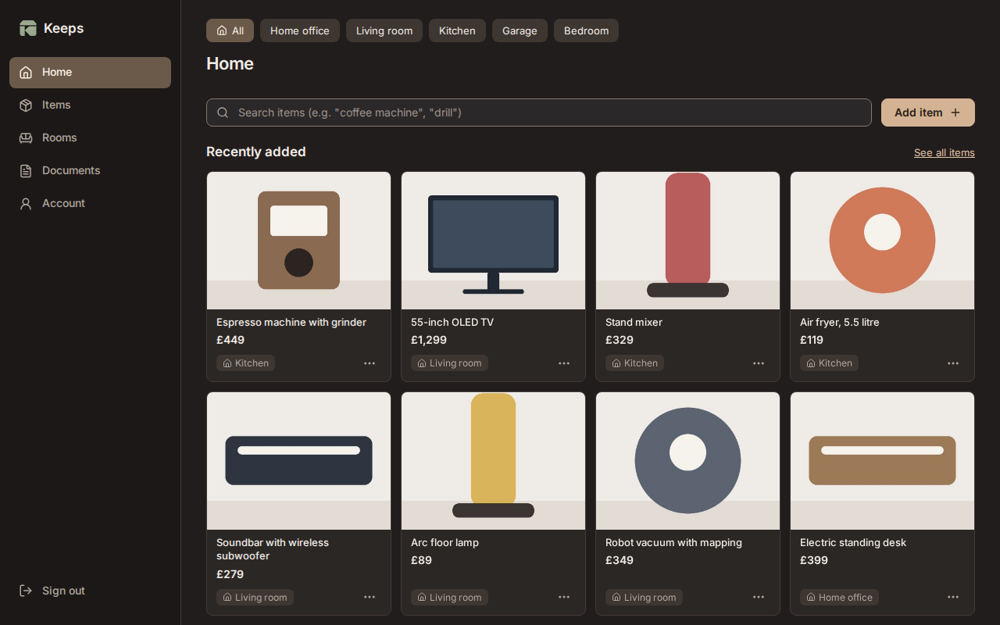
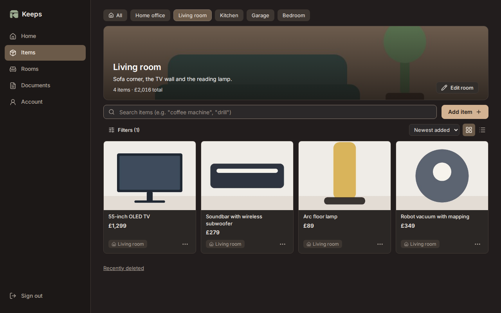
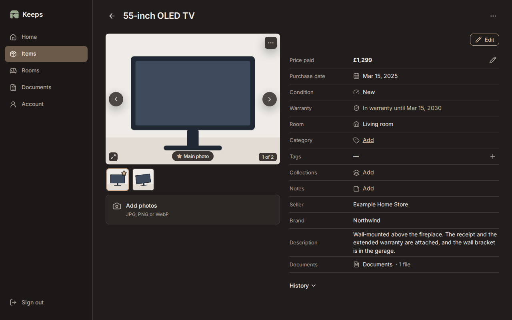
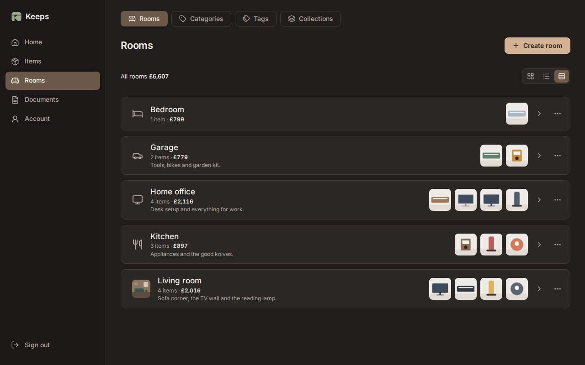
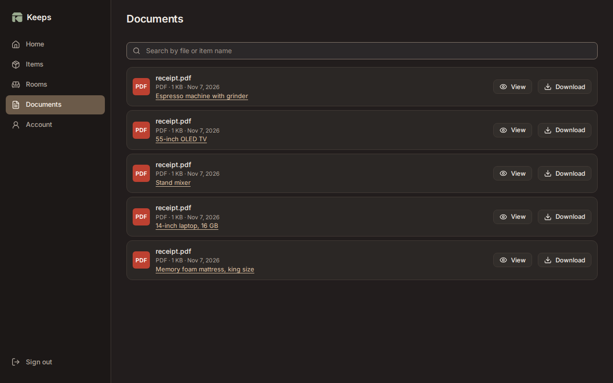
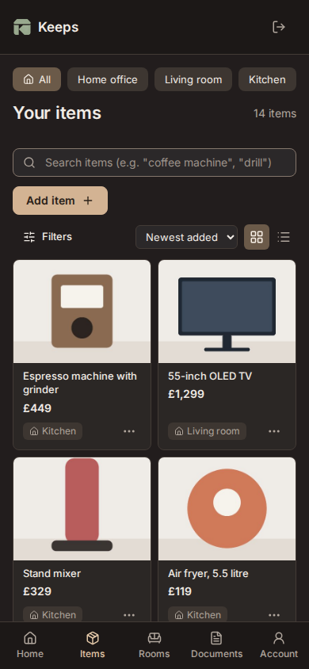

<p align="center"></p>

# Keeps

A self-hosted home library for what you own: where each thing lives, what it cost, and the receipt that proves it.

Add a belonging in seconds by name, from a shop link, or with the **Add to Keeps** button while you browse a shop. Keeps files it in a room, and you can find the receipt, warranty and photos again years later, when you sell something, claim on insurance or need a repair.



## What it does

- **Rooms first.** Every room has its own page with an optional photo and description, its items, and what they cost in total. Rooms show as cards, a list or wide rows.
- **Items with their proof.** Each item can have several photos (you pick the main one), invoices and documents, the price paid, purchase date, seller, brand, model, serial number, condition and warranty end date. An item bought as several, like a pair of speakers, can keep each unit's own serial number and a label telling them apart.
- **Add from a shop.** Paste a product link and Keeps reads the name, price and photos for you to check before saving. For shops that block that, the **Add to Keeps** bookmark button sends the page you're already looking at.
- **Documents open in Keeps.** Read a PDF receipt or manual on the page, without downloading it.
- **Find anything.** Full-text search, plus filters for room, category, tag, collection, condition, warranty and receipts.
- **Costs.** The total for every room and for the whole home, in each currency you paid in.
- **Your data stays yours.** Encrypted backups you can restore from the browser, a CSV for spreadsheets, and a full export with every original file. Deleted items wait in Recently deleted first.
- **Secure sign-in.** Passwords, optional authenticator codes and passkeys. Everything stays on your server, with no third-party services.
- **Works on a phone.** The same app, laid out for small screens, in dark or light.

## Screenshots

| A room                                                               | An item                                                                        |
| -------------------------------------------------------------------- | ------------------------------------------------------------------------------ |
|  |  |

| Rooms                                                             | Documents                                                                  |
| ----------------------------------------------------------------- | -------------------------------------------------------------------------- |
|  |  |

| Items                                                            | On a phone                                            |
| ---------------------------------------------------------------- | ----------------------------------------------------- |
|  |  |

## Install

Keeps is one container on a **Linux amd64** host with Docker Engine and the Compose plugin. It needs an **HTTPS address**, such as `https://keeps.example.com`: browsers only allow sign-in cookies and passkeys on secure addresses.

Behind a reverse proxy you already run (Caddy, nginx, Traefik, Nginx Proxy Manager):

1. Download [`docker-compose.yml`](docker-compose.yml) and [`.env.example`](.env.example) into a new folder, saving the second as `.env`:

   ```bash
   curl -fLO https://raw.githubusercontent.com/aiulian25/keeps/main/docker-compose.yml
   ```

   ```bash
   curl -fL -o .env https://raw.githubusercontent.com/aiulian25/keeps/main/.env.example && chmod 600 .env
   ```

2. Set your address in `.env`:

   ```dotenv
   APP_ORIGIN=https://keeps.example.com
   ```

3. Start it:

   ```bash
   docker compose up -d
   ```

4. Point your proxy at `127.0.0.1:6030`, then get the one-time setup code and open your address to create the admin:

   ```bash
   docker compose logs keeps | grep "setup code"
   ```

To upgrade, back up from the app, then run `docker compose pull && docker compose up -d`. See [docs/upgrade.md](docs/upgrade.md).

No proxy yet? [`deploy/proxy/`](deploy/proxy) runs Keeps with Caddy and automatic HTTPS, and [`deploy/direct-tls/`](deploy/direct-tls) uses your own certificate files. [docs/install.md](docs/install.md) covers all three, storage and scheduled backups.

## Security

- Runs as an unprivileged user (74532) in a distroless image with no shell, a read-only root filesystem and every Linux capability dropped.
- Server-side sessions, CSRF protection, a strict Content Security Policy and Argon2id password hashing.
- Shop links are fetched through a guard that refuses private and local network addresses.
- Backups are encrypted with [age](https://age-encryption.org), with a passphrase or a public key.

## Documentation

- [Install](docs/install.md)
- [Upgrade](docs/upgrade.md): back up first; Keeps never updates itself.
- [Recovery](docs/recovery.md): restoring backups and regaining admin access.
- [API](docs/api.md)
- [Which shops import well](docs/import-coverage.md)

## Development

Go and Node.js are needed. The web app is React and TypeScript, built into the Go binary.

```bash
npm ci && npm --prefix web ci
```

The Go binary embeds the built web app, so build before linting or testing:

```bash
npm run prettier-check && npm run build && npm run lint && npm test
```

End-to-end tests build and run the real binary on port 6030 with throwaway data in `.e2e-data/` (stop anything else on that port first; the tests refuse to run against it). The test server only ever deletes a data folder it created itself:

```bash
npm --prefix web run e2e
```

The screenshots above come from made-up data on a fresh instance:

```bash
README_SCREENSHOTS=1 npm --prefix web run e2e -- readme-screenshots
```

## License

[MIT](LICENSE)
